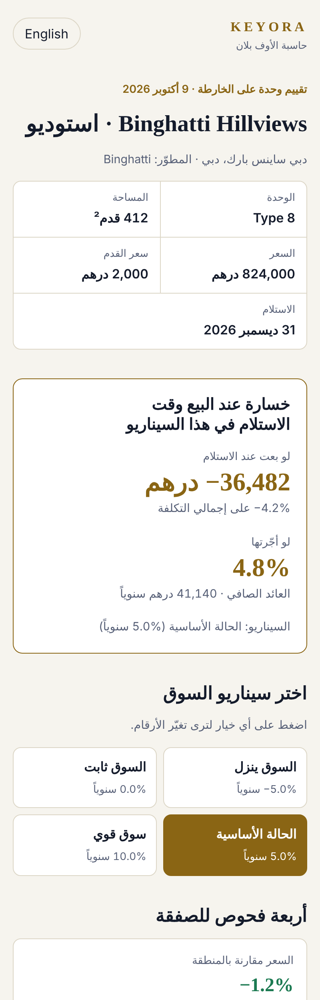
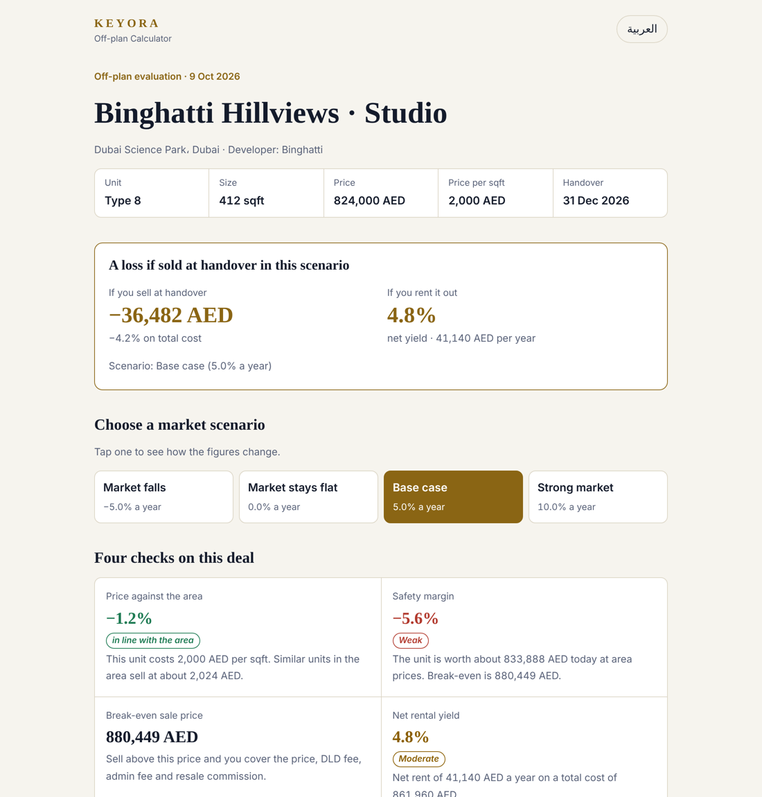

# KEYORA · Off-plan Calculator

by **Hassan Abu El-Leil** · حسن أبو الليل

A **Claude skill** that turns one Dubai off-plan unit into a client-ready evaluation report, in
**Arabic and English**, with every calculation shown and every number traced to its source.

<p>


</p>

Open the full example: [examples/binghatti-hillviews-studio.html](examples/binghatti-hillviews-studio.html)
(download it and open it in a browser).

## What the report contains
- **Verdict**: profit if you sell at handover, net rent and net yield
- **Four checks**: price against the area, safety margin, break-even sale price, net yield
- **Four market scenarios**: market falls, stays flat, base case, strong market
- **Supply and demand**: what is selling, how much of the project is sold, what is being built
- **Payment plan** and the cash needed before handover
- **A "confirm before relying on this" box** listing every placeholder and unconfirmed figure
- **Every calculation**, step by step
- **Sources**, each with its period and the date it was pulled
- **Your footer**: name, company, BRN, WhatsApp button, logo and photo
- One button switches the whole report between **العربية** and **English**

## Install
You need **Claude** with skills and code execution (Claude Code, or the Claude desktop app),
plus **Python 3** and **Node.js**.

Paste this into Claude:

> Install the KEYORA calculator: https://github.com/SH3POZ/Keyora-Dubai-

Or run it yourself:
```bash
git clone https://github.com/SH3POZ/Keyora-Dubai-.git ~/.claude/keyora
bash ~/.claude/keyora/install.sh
```
Then ask: *"Make a KEYORA off-plan report for this unit"* and attach the sales offer, or give the
project name.

**Update:** `cd ~/.claude/keyora && git pull && bash install.sh`

## Data sources
The skill reads DXB Interact first, then Bayut market analysis, Property Finder transactions and
Google Maps. A sales offer from the developer gives the most accurate result. Details:
[sources.md](skills/keyora-offplan/references/sources.md).

## How it works
| File | Purpose |
|---|---|
| `skills/keyora-offplan/SKILL.md` | the instructions Claude follows |
| `references/` | the steps, the sources, and every formula |
| `kit/calc.js` | all the maths |
| `kit/check.js` | re-derives the figures a second way and compares |
| `kit/build.py` + `kit/template.html` | data file in, report page out |
| `kit/data/` | a complete real example |

Try it:
```bash
cd skills/keyora-offplan/kit
node check.js data/example-binghatti-hillviews-studio.json
python3 build.py data/example-binghatti-hillviews-studio.json
```

## Status
Version 1.0. Built and tested on Linux with Python 3.13 and Node 22. Not yet tested on macOS or
Windows. More calculators (ready property, mortgage, holiday home) are planned.

## License
© 2026 Hassan Abu El-Leil. Free to use for your own client reports. Keep the credit line on every
report. No resale. Full terms: [LICENSE](LICENSE).

## Disclaimer
Reports are estimates from market data and developers' published information. They are not
financial advice.

---

<div dir="rtl">

# كيورا · حاسبة الأوف بلان

إعداد **حسن أبو الليل**

**Skill لـ Claude** بتحوّل أي وحدة أوف بلان في دبي لتقرير تقييم جاهز للعميل، **بالعربي والإنجليزي**،
وكل رقم فيه مكتوب مصدره وطريقة حسابه.

## التقرير فيه إيه
- **الحكم**: الربح لو بعت عند الاستلام، وصافي الإيجار والعائد
- **أربع فحوص**: السعر مقارنة بالمنطقة، هامش الأمان، سعر التعادل، العائد الصافي
- **أربع سيناريوهات للسوق**: ينزل، ثابت، الحالة الأساسية، سوق قوي
- **العرض والطلب**: إيه اللي بيتباع، نسبة المباع في المشروع، والمعروض القادم
- **خطة الدفع** والسيولة المطلوبة قبل الاستلام
- **خانة "يجب التأكد منه"** فيها كل رقم مؤقت أو غير مؤكد
- **كل الحسابات** خطوة بخطوة، و**المصادر** بتاريخ سحبها
- **الفوتر بتاعك**: الاسم، الشركة، BRN، زرار واتساب، اللوجو والصورة

## التثبيت
اكتب في Claude:

> Install the KEYORA calculator: https://github.com/SH3POZ/Keyora-Dubai-

وبعدها اطلب: *"اعملي تقرير KEYORA للوحدة دي"* وارفق عرض البيع أو اكتب اسم المشروع.

## الرخصة
الاستخدام مجاني لتقاريرك مع عملائك. سطر الحقوق يفضل على كل تقرير. إعادة البيع ممنوعة.

التقارير تقديرات وليست نصيحة مالية.

</div>
